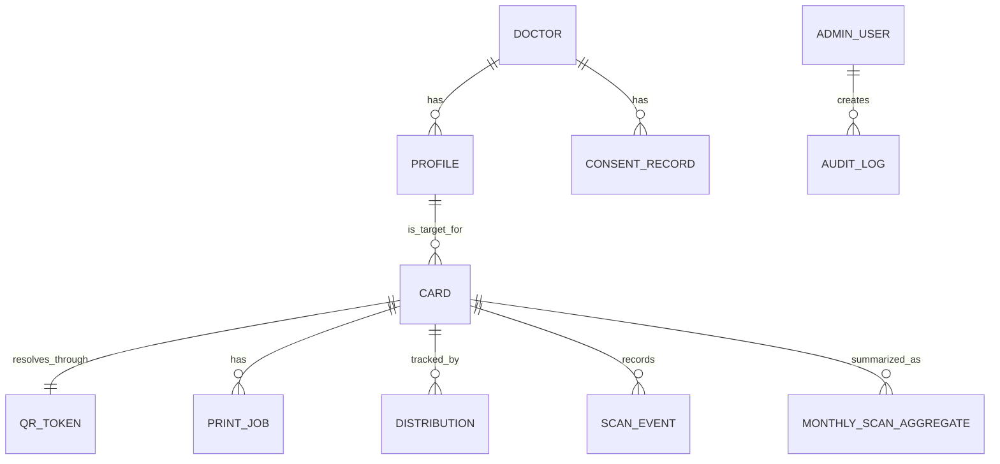

# P1.2 — Technical Specification

**Status:** Proposed baseline for MVP
**Product:** Dedicated doctor QR-card management tool
**Architecture:** Modular monolith; one company; admin-operated profiles.

## 1. Technology baseline

- **Application:** Next.js + TypeScript.
- **Data:** PostgreSQL + Prisma ORM and migrations.
- **Deployment:** One web application and managed PostgreSQL. Provider choice is deferred until environment/deployment requirements are confirmed.
- **Storage:** Private object storage for source photos and generated print files; public profile images served through controlled, size-limited paths.
- **Authentication:** Company-admin authentication from the first real-data deployment; no doctor accounts in the MVP.
- **Background work:** Scheduled task for scan-event expiry, with observable success/failure and retry behavior.
- **Architecture:** Modular monolith with clear domain boundaries; do not split into microservices for the MVP.

## 2. Application modules

1. **Admin / Auth:** Staff access, roles, session controls, audit trail.
2. **Doctors:** Internal doctor records and search/list operations.
3. **Profiles:** Validation, consent gate, preview, publication state, public rendering.
4. **Cards:** Serials, edition, template version, card lifecycle.
5. **QR:** Secure token generation, token lookup, redirect/render decision, card suspension behavior.
6. **Print:** Template inputs, preview, print-job records, PDF generation adapter.
7. **Analytics:** QR-request event recording, monthly aggregation, 60-day expiry.
8. **Distribution:** Manual print/distribution state and handoff history.

Keep module boundaries in code and service contracts, but use a single deployable application and database initially.

## 3. Initial entity relationships

### Relationship rules for MVP

- One doctor may have profile revisions/versions; only one profile version is current and published at a time.
- A card points to the doctor's profile identity/current published version, not a hard-coded copy of public fields. Editing the profile does not require printing a new QR.
- A doctor may have more than one card over time. Each physical card has its own serial and QR token.
- Each card has one active QR token at a time. Token rotation is an explicit administrative/security action and requires reprinting if the token is printed on the card.
- Every print job captures the card, template version, generated file reference, and status so later template changes do not rewrite print history.
- Consent records are separate from the profile payload and are required for publication.

## 4. Suggested core fields and constraints

- **Doctor:** opaque ID, internal reference (optional), created/updated timestamps, archived state.
- **Profile:** opaque ID, doctor ID, version, Arabic name, optional public fields, draft/published/unpublished state, published timestamp.
- **ConsentRecord:** doctor/profile ID, scope, state, recorded/revoked timestamps, administrator ID, evidence reference/text version.
- **Card:** opaque ID, doctor/profile reference, unique serial, edition, lifecycle state, template version, created/updated timestamps.
- **QRToken:** card ID, unique token hash, created/revoked timestamps. Store a cryptographically random token; store only its hash where feasible.
- **PrintJob:** card ID, template version, output dimensions, file reference, state, created-by and timestamp.
- **Distribution:** card ID, state/date, responsible administrator, minimal notes.
- **ScanEvent:** card ID, event timestamp, minimal non-identifying operational fields; expires after 60 days.
- **MonthlyScanAggregate:** unique `(card_id, month)` pair and count; retained after event expiry.
- **AdminUser / AuditLog:** role, actor, action, target, timestamp, minimal before/after metadata.

Use opaque IDs and database uniqueness constraints for serials and token hashes. Do not expose sequential database IDs in public URLs.

## 5. QR route and card lifecycle

### Public request flow

1. Visitor opens `/c/{opaque-random-token}`.
2. QR module hashes/looks up the token and resolves its card.
3. If token/card is invalid, revoked, or suspended, return a neutral unavailable response; do not reveal internal status or doctor records.
4. If card is valid but the profile is unpublished or consent is invalid, return an unavailable/pending page with no private profile data.
5. If valid and published, record one scan request and render the current public profile.

QR token entropy must be generated with a cryptographically secure random generator. The token must be unguessable and rate-limited against automated abuse. Avoid placing personal details in the QR URL.

### Card states

`Draft → ReadyForPrint → Printed → Distributed → Active`

Administrative states: `Suspended`, `Revoked`.

Transitions are validated server-side and audited. Do not equate profile state with card state. The sample card is explicitly marked as a demo and must not expose a real person's data without consent.

## 6. Scan analytics and retention

- A scan means a successful request to a valid card QR route; it does not prove a human viewed the page.
- Count each qualifying request. Do not attempt visitor identity, cross-device uniqueness, contact-action tracking, or patient tracking.
- Record the minimum event needed to increment the per-card monthly aggregate and support 60-day deletion. Avoid storing IP address or user-agent unless a narrowly scoped security need is approved.
- Increment/upsert the monthly aggregate atomically with event recording to prevent lost counts under concurrent requests.
- Keep detailed events for at most 60 days, then delete them automatically. Retain the monthly `(card, calendar month, count)` aggregate.
- Make timezone for month boundaries explicit (UTC for storage/aggregation unless product reporting requires a different agreed zone).
- Cleanup and aggregation behavior require automated tests, monitoring, and a failure alert.

## 7. API / service boundaries

Prefer typed domain services over exposing database operations directly to UI components. Initial logical operations:

- Admin: create/update/archive doctor; create/update/preview/publish profile; record/revoke consent.
- Cards: create card, allocate serial/token, transition status, suspend/revoke.
- Public: resolve QR token and return only published, consented public fields.
- Print: generate preview/export for a specific card/template version; record print job.
- Analytics: increment scan, query monthly per-card aggregates; scheduled cleanup of old detail events.
- Distribution: record/modify handoff state with audit history.

Exact REST/server-action shape is an implementation choice; enforce authorization and validation at the server boundary regardless of transport.

## 8. Security and operational requirements

- Protect admin routes and all mutations with authenticated, authorized server-side checks.
- Validate/normalize inputs on the server; sanitize plain text and allow only safe HTTPS link schemes.
- Restrict photo uploads by type, dimensions, and size; avoid serving original uploads directly.
- Use CSRF-safe mutation patterns, secure session settings, rate limits for public QR routes, and appropriate security headers.
- Keep secrets out of source control; separate development and production configuration.
- Apply schema migrations and test backups/restore before production use.
- Audit profile publication, consent changes, card state changes, print exports, and distribution edits.

## 9. Vertical-slice acceptance criteria

The first end-to-end implementation is complete when:

1. An authenticated administrator creates a doctor and a draft profile.
2. The profile cannot be published without required consent; public data validation passes.
3. An administrator creates a card with a unique serial and secure QR token.
4. A public QR URL displays the current profile on mobile when card and profile are active/published.
5. Editing public profile details changes the page without changing the QR URL.
6. Suspended/revoked card and unpublished profile requests reveal no public doctor data.
7. A qualifying QR request updates the correct monthly aggregate.
8. Detailed events older than 60 days are removed by a tested scheduled task; monthly aggregates remain.
9. A print job can be generated against a versioned template after supplier print specifications are approved.
10. Critical actions are authorized and leave an audit record.

## 10. Deferred decisions

- Hosting/deployment provider and domain.
- Admin identity provider and exact roles.
- Whether public profile needs English localization beyond optional English name.
- Final PDF library and color-management capabilities, selected after a proof with the printer.
- Exact schema for edition/template versioning after current draft assets are audited.
